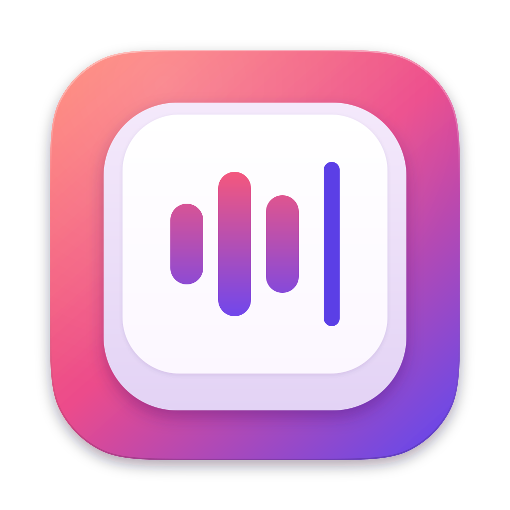
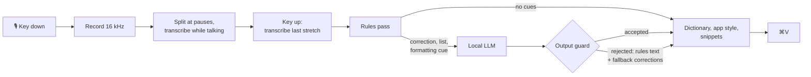

<div align="center">



# Quietype

**Dictation for macOS that keeps quiet.**

Hold a key, talk, let go. Clean text appears wherever your cursor is.<br>
Speech recognition and LLM cleanup both run on your Mac, so nothing you say is sent anywhere.

[](https://github.com/noahweiss3/quietype/actions/workflows/ci.yml)
[](https://github.com/noahweiss3/quietype/actions/workflows/evals.yml)
[](LICENSE)


[Features](#features) · [Install](#install) · [Usage](#usage) · [How it works](#how-it-works) · [Quality](#quality) · [Contributing](#contributing)

<picture>
  <source media="(prefers-color-scheme: dark)" srcset="docs/assets/demo-dark.svg">
  
</picture>

<sub>An illustration of the workflow, not a screen recording.</sub>

</div>

| You say | Quietype types |
|---|---|
| "Um, so I think we should, uh, push the launch to next week." | So I think we should push the launch to next week. |
| "Let's do the call at 2, **no wait**, 3 PM." | Let's do the call at 3 PM. |
| "I want pizza and wings, **scrap that, not the wings**." | I want pizza. |
| "Groceries: **first** eggs, **second** milk, **third** bread. **Scratch the bread.** Fourth coffee." | Groceries:<br>1. Eggs<br>2. Milk<br>3. Coffee |
| "Are we still on for lunch **question mark**" | Are we still on for lunch? |
| "Send them **my LinkedIn**, **no wait**, my GitHub." | Send them https://github.com/jlee. |

<sub>Each row is a case from the [eval suites](evals/README.md) and the output Quietype produced for it with the default Qwen3 4B model.</sub>

## Features

- **Fully on-device.** NVIDIA Parakeet transcribes on the Neural Engine and a Qwen3 model cleans up text with llama.cpp on the GPU. Quietype never sends your audio or text anywhere; it only goes online to download models.
- **Fast where it matters.** Speech is transcribed while you are still talking, so letting go of the key usually only waits for the stretch since your last pause. Plain sentences skip the LLM entirely and paste at transcription speed.
- **Understands how people actually talk.** Removes fillers and stutters, and applies spoken corrections: "no wait", "scratch that", "I mean", "not the wings", "start over".
- **Formats as you speak.** Numbered and bulleted lists, "new paragraph", spoken punctuation.
- **Writes for the app you're in.** No stray period in editors and terminals. When the LLM runs (in Smart mode, only for dictations that need it), it also keeps chat casual in Slack and Messages, writes full sentences in Mail, and leaves identifiers exactly as spoken in code.
- **Snippets.** Say a trigger like "my LinkedIn" or "my email signature" anywhere in a sentence and the stored text is pasted verbatim.
- **Personal dictionary.** Teach it names and jargon, or map a mishearing (`cooper netties -> Kubernetes`).
- **Live meeting notes.** Transcribes your microphone and the call's audio, with no bot joining the call, and keeps a running summary, decisions, action items and open questions as you talk.
- **Measured, not guessed.** Cleanup behaviour is pinned by unit tests and by eval suites that run the app's real pipeline against a local LLM in CI.

## Install

**Requirements:** an Apple Silicon Mac (M1 or later) on macOS 14 or later, Xcode 16 or later to build, and about 3 GB of disk for models. 16 GB of RAM is recommended for the default 4B cleanup model; the 1.7B model works with 8 GB.

```sh
git clone https://github.com/noahweiss3/quietype.git
cd quietype
make run
```

`make run` builds `build/Quietype.app` and opens it. Quietype lives in the menu bar. On first launch:

1. **Microphone:** allow it when asked.
2. **Accessibility:** needed for the global hotkey and for pasting. Click *Grant…* in Settings, then enable Quietype in System Settings › Privacy & Security › Accessibility.
3. **Speech model:** Parakeet downloads and compiles automatically, which takes about a minute the first time.
4. **Cleanup model:** click *Download Qwen3 4B Instruct (recommended)* in Settings (2.5 GB).

Move `build/Quietype.app` to `/Applications` to keep it and launch it at login.

**Prebuilt app.** There is no release yet. Every [CI run on `main`](https://github.com/noahweiss3/quietype/actions/workflows/ci.yml?query=branch%3Amain) uploads an ad-hoc signed `Quietype.zip` as the run's `Quietype-app` artifact, kept for 14 days (downloading it needs a GitHub account). It isn't notarized, so the first time you open it macOS asks you to approve it under System Settings › Privacy & Security.

> [!NOTE]
> macOS ties the Accessibility permission to the app's code signature, and the default ad-hoc signature changes on every build. After rebuilding, re-grant it, or build with a stable identity: `QUIETYPE_SIGN_IDENTITY="Apple Development: you@example.com" make app`.

## Usage

| Action | Result |
|---|---|
| Hold **Right Option** | Records while held, pastes on release |
| Double-tap **Right Option** | Hands-free: records until you tap once more |
| **Esc** while recording | Cancels |

The key can be changed to Right ⌘, Right ⌃ or Fn/🌐 in Settings.

**More things you can say**

- "The meeting is on Monday. **Scratch that.** The meeting is on Wednesday." → *The meeting is on Wednesday.*
- "Hey Sarah, so the thing is. **Start over.** Hi Sarah, quick question about the budget." → *Hi Sarah, quick question about the budget.*
- "Hi Alex, **new paragraph**, thanks for the quick turnaround on this." → a paragraph break after the greeting
- "To set it up, **first** install the CLI, **second** run the login command, and **third** deploy the project." → a numbered list
- "I want pizza, not wings." → left alone, because nothing was taken back

**Snippets.** Add a trigger and its text in Settings › Snippets, for example `my LinkedIn` → `https://www.linkedin.com/in/you`. Matching ignores case, punctuation and spacing ("my linked in" works) but only matches whole words. Snippets expand after cleanup, so "send them my LinkedIn, no wait, my GitHub" pastes only the GitHub link.

**Meeting notes.** Choose *Start Meeting Notes* from the menu bar. Quietype records your microphone (*You*) and the Mac's audio output (*Others*, through ScreenCaptureKit, which asks for Screen & System Audio Recording permission). About once a minute the local LLM folds the new conversation into the notes, and when someone changes their mind the notes keep the final version. *Stop* saves the notes and a timestamped transcript as Markdown. Without headphones the microphone also hears the call, so microphone segments that repeat what just played through the speakers are dropped. Dictation is paused while a meeting is recording.

**Settings**

- **Cleanup mode:** *Smart* (default) runs the LLM only when the transcript needs it. *Always* runs it on every dictation. *Rules only* never uses the LLM for dictation (meeting notes still load it).
- **Cleanup model:** Qwen3 4B Instruct (best quality) or Qwen3 1.7B (smaller and faster, weaker on subtle corrections).
- **Speech model:** Parakeet Ultra (most accurate, 25 languages), Parakeet v2 (English) or Phonon-2 (English, fastest, macOS 15+). Cleanup rules and prompts are written for English.
- **Dictionary:** one term per line. `Kubernetes` fixes spelling and casing; `cooper netties -> Kubernetes` replaces a mishearing.
- **History:** recent dictations with the raw transcript, the cleaned text and per-stage timings. On by default; turn off *Keep history* to stop saving new dictations.

## How it works



Most of the speed comes from avoiding work rather than doing it faster:

1. **Transcribe while you talk.** The recording is split at pauses and finished stretches are transcribed in the background, so at release only the stretch since your last pause is left. That keeps the wait flat however long you speak, as long as you pause now and then and transcription keeps up: one long stretch with no pause is transcribed in full at release, and any earlier stretch still queued behind a slow transcription adds to the wait.
2. **Skip the LLM when it isn't needed.** A deterministic rules pass removes fillers, stutters and standalone "start over". The LLM runs only when the transcript contains a cue: a correction ("scratch that", "no wait", "I mean"), a list ("first… second…", "bullet point"), a formatting command ("new paragraph", "comma") or a filler the rules can't safely remove ("you know", "like").
3. **Cache the prompt.** The system prompt and few-shot examples are evaluated once when the model loads. Each dictation evaluates only its own text.
4. **Speculative decoding from the input.** Cleanup output is mostly a copy of the input, so the decoder proposes upcoming tokens straight from the dictation and verifies up to 12 at once. Output is identical to plain greedy decoding (`quietype-bench --compare` checks this). It only saves time on GPUs where checking a batch of tokens costs little more than checking one, so Quietype times a batch when the model loads and switches speculation off everywhere else. It was off on the M2 Air behind the numbers below.
5. **Guard the output.** If the LLM answers the dictation instead of cleaning it ("write me a poem" → a poem), invents content, or returns nothing for no reason, Quietype pastes the rules-pass text instead.

**Stage timings** from `quietype-bench`, with both models loaded before timing:

| Dictation | Audio | Path | Transcribe at release | LLM cleanup |
|---|---:|---|---:|---:|
| "Thanks for sending the deck over, I will take a look…" | 5.0 s | rules only | 73 ms | – |
| "Um, so I think we should, uh, push the launch to next week." | 3.8 s | rules only | 59 ms | – |
| "Let's do the call at 2, no wait, 3 PM." | 2.8 s | LLM | 57 ms | 565 ms |
| "…three things. First, a venue. Second, catering…" | 9.7 s | LLM, list | 95 ms | 1,654 ms |

<sub>Per-stage timings, not key-release-to-paste latency. One run per clip on a MacBook Air (M2, 16 GB); [method and how to reproduce](docs/benchmarks.md#stage-timings).</sub>

The full design, module boundaries and extension points are in [docs/architecture.md](docs/architecture.md).

## Quality

Cleanup quality is measured by eval suites that run the app's own rules, prompt and guard (through `quietype-cli`) against a llama.cpp server. CI runs them on every change to the cleanup code and fails if any suite drops below its recorded baseline.

| Suite | Cases | What it covers | Qwen3 4B |
|---|---:|---|---:|
| [Cleanup](evals/cases/cleanup.jsonl) | 35 | Fillers, corrections, "start over", lists, formatting commands, prompt injection, per-app style, vocabulary | **35/35** |
| [Corrections](evals/cases/corrections.jsonl) | 46 | Taking things back, replacements, additions, chained revisions, and look-alikes that must be left alone | **45/46** |
| [Corrections, extended](evals/cases/corrections-extended.jsonl) | 25 | Less common wordings ("strike X", "swap X for Y"), corrections after a filler, two revisions in one sentence | **22/25** |
| [Holdout](evals/cases/holdout.jsonl) | 60 | Corrections never used while tuning the prompt | **52/60** |
| [Snippets](evals/cases/snippets.jsonl) | 12 | Snippet expansion through the whole pipeline, including corrections between snippets | **12/12** |
| [Meeting notes](evals/meetings) | 33 checks | Two replayed meetings, checked with fixture assertions: expected names, tasks and phrases appear in the right section (and abandoned proposals don't), and every live update succeeds | **33/33** |

<sub>Run 2026-10-21 on a MacBook Air (M2, 16 GB) at temperature 0. The meeting checks are substring assertions, not an accuracy score. [Setup and how to reproduce](docs/benchmarks.md#eval-scores).</sub>

The holdout suite exists to catch a prompt that has overfitted to the other suites. See [evals/README.md](evals/README.md) for the case format and how to run everything yourself.

## Privacy

- Audio is processed in memory and never written to disk or sent anywhere.
- The only network traffic is downloading the speech and cleanup models.
- Quietype stores, in `~/Library/Application Support/Quietype/`:
  - `history.json`: your last 100 dictations (raw and cleaned text, the app you dictated into, timings), in plain JSON. Turn off *Settings › History › Keep history* and new dictations aren't saved. If it can't be read, it is kept beside it as `history.unreadable-<date>-<time>.json` and a new history is started. *Settings › History › Clear History* deletes the history and those kept copies.
  - `Meetings/`: notes and transcripts you chose to record, as Markdown.
  - `Models/`: the cleanup models.
- Settings, your personal dictionary and your snippets (including their text) are stored in plain form in UserDefaults, domain `com.noahweiss.quietype`.
- Speech models are kept in FluidAudio's cache, `~/Library/Application Support/FluidAudio/`.
- Pasting goes through the clipboard: Quietype puts the text there, sends ⌘V, then restores what was on the clipboard before.

## Limitations

- **English only for cleanup.** Speech recognition can use other languages with Parakeet Ultra, but the rules and prompts are written for English.
- **Echo suppression is a heuristic.** Without headphones, a microphone segment is dropped when it overlaps call audio in time and repeats most of its words in order. It can miss an echo the microphone picked up differently, or drop something you said over the other person that repeats their words.
- **Everyone on the call is "Others".** Meeting transcripts tell your microphone apart from the Mac's audio output, not one remote speaker from another.
- **Per-app styles go by app.** Styles are chosen by the frontmost app's bundle ID, so Slack or Gmail in a browser tab gets the browser's style (the default), not the chat or email one.

## Troubleshooting

<details>
<summary><b>Nothing happens when I hold the key</b></summary>

Check that Quietype is enabled in System Settings › Privacy & Security › Accessibility. If you rebuilt the app, remove Quietype from the list and add it again.
</details>

<details>
<summary><b>The Fn key opens the emoji picker</b></summary>

Set System Settings › Keyboard › "Press 🌐 key to" to "Do Nothing", or use Right Option.
</details>

<details>
<summary><b>Text doesn't paste in one app</b></summary>

Some apps block synthetic ⌘V. The text is still in History; click it in the menu bar's *Recent* submenu to copy it.
</details>

<details>
<summary><b>Debugging the cleanup model</b></summary>

Run the app binary directly to see llama.cpp's logs: `QUIETYPE_LLAMA_LOG=1 build/Quietype.app/Contents/MacOS/Quietype`.
</details>

## Contributing

Contributions are welcome, and eval cases that show Quietype getting something wrong are especially useful. Start with [CONTRIBUTING.md](CONTRIBUTING.md) for setup, tests and evals, and [docs/architecture.md](docs/architecture.md) for how the code fits together.

```
Sources/
  QuietypeCore/     portable logic, tested on macOS and Linux: rules, prompt, guard,
                    speculative decoding, segmentation, snippets, meeting notes
  QuietypeKit/      macOS adapters: Parakeet transcriber, llama.cpp runner, model downloads
  Quietype/         the menu bar app (AppKit + SwiftUI)
  quietype-cli/     JSON front end over QuietypeCore, used by the evals
  quietype-bench/   headless pipeline that prints per-stage timings
Tests/              unit tests, mirroring Sources/
evals/              cleanup and meeting-notes eval suites and runners
docs/               architecture and benchmark methodology
scripts/            app bundling and signing
```

## Acknowledgements

Quietype is built on [llama.cpp](https://github.com/ggml-org/llama.cpp) (MIT) and [FluidAudio](https://github.com/FluidInference/FluidAudio) (Apache 2.0). It downloads speech models based on [NVIDIA Parakeet](https://huggingface.co/nvidia/parakeet-tdt-0.6b-v3) (CC-BY-4.0) through FluidAudio and [Qwen3](https://huggingface.co/Qwen) cleanup models (Apache 2.0) as GGUF files from [Unsloth](https://huggingface.co/unsloth). Each model is subject to its own license. [THIRD_PARTY_NOTICES.md](THIRD_PARTY_NOTICES.md) has the full notices and credits each model.

## License

Quietype is released under the [MIT License](LICENSE).
