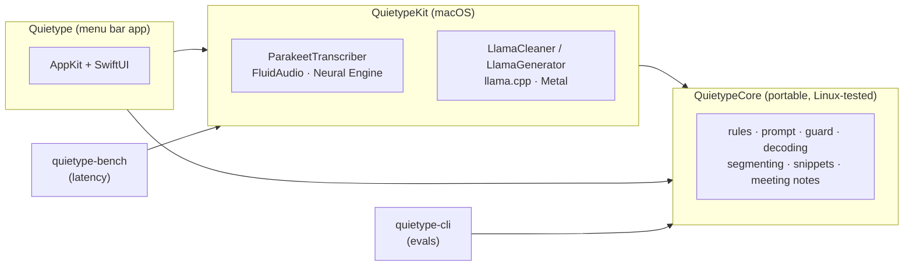
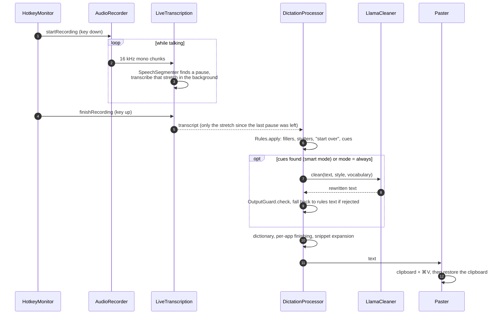

# Architecture

Quietype is a Swift package with three layers and two command-line tools. The rule that shapes everything else: **all behaviour that can be tested without a Mac lives in `QuietypeCore`**, behind small protocols, and the macOS layers only adapt hardware and models to those protocols.

| Target | Platform | Responsibility |
|---|---|---|
| `QuietypeCore` | macOS, Linux | Every decision about text and timing: the rules pass, cue detection, the cleanup prompt, the output guard, speculative decoding, the hotkey state machine, pause segmentation, live transcription, snippets, the personal dictionary, meeting transcripts and the live-notes writer. No AppKit, no models. |
| `QuietypeKit` | macOS | Adapters that implement `QuietypeCore` protocols with real models: `ParakeetTranscriber` (`SpeechTranscriber`), `LlamaCleaner` (`TextCleaner`), `LlamaGenerator` (`TextGenerator`), plus model downloads (`ModelStore`). |
| `Quietype` | macOS | The menu bar app: global hotkey, microphone and system-audio capture, the recording HUD, pasting, settings, history and the meeting window. |
| `quietype-cli` | macOS, Linux | A JSON-lines front end over `QuietypeCore` so the [evals](../evals/README.md) run the app's exact rules, prompt and guard against any llama.cpp server. The chat template is rendered by different code there; [evals/README.md](../evals/README.md#the-chat-template) explains. |
| `quietype-bench` | macOS | Runs the pipeline headless on audio files or text and prints per-stage timings (transcription left at the end of the input, LLM prefill and generation), not key-release-to-paste latency. `--compare` checks that speculative decoding produces the same output as plain greedy decoding, and `--expect` fails the run when a transcript or cleanup misses the expected words (the End-to-end workflow uses both). |

## Dictation pipeline

One dictation, from key press to pasted text:

| Stage | Type | File |
|---|---|---|
| Key handling | `HotkeyStateMachine` (pure), `HotkeyMonitor` (NSEvent) | `QuietypeCore/Hotkey/`, `Quietype/Dictation/HotkeyMonitor.swift` |
| Capture | `AudioRecorder` | `Quietype/Audio/AudioRecorder.swift` |
| Transcribe while talking | `LiveTranscription`, `SpeechSegmenter` | `QuietypeCore/Audio/` |
| Speech model | `ParakeetTranscriber` | `QuietypeKit/ASR/` |
| Deterministic cleanup | `Rules`, `Words` | `QuietypeCore/Cleanup/Rules.swift`, `Words.swift` |
| LLM cleanup | `CleanupPrompt`, `LlamaCleaner` | `QuietypeCore/Cleanup/CleanupPrompt.swift`, `QuietypeKit/LLM/` |
| Speculative decoding | `PromptLookupDrafter`, `SpeculativeDecoder` | `QuietypeCore/LLM/` |
| Safety net | `OutputGuard` | `QuietypeCore/Cleanup/OutputGuard.swift` |
| Orchestration | `DictationProcessor` | `QuietypeCore/Dictation/DictationProcessor.swift` |
| Per-app style | `AppStyles`, `WritingStyle` | `QuietypeCore/Text/AppStyles.swift`, `QuietypeCore/Cleanup/CleanupPrompt.swift` |
| Vocabulary and shortcuts | `PersonalDictionary`, `Snippets` | `QuietypeCore/Text/` |
| Output | `Paster`, `HistoryStore` | `Quietype/Dictation/Paster.swift`, `QuietypeCore/Dictation/HistoryStore.swift` |

### Why it is fast

Most of the latency win comes from not doing work:

- **Transcribe while talking.** `LiveTranscription` hands each finished stretch to the transcriber as soon as `SpeechSegmenter` sees a pause (0.5 s, once the stretch is at least 4 s long), so key-up only waits for the audio since the last pause, plus any stretch still queued if transcription has fallen behind. Dictation sets no maximum stretch length, so one long stretch with no pause is transcribed in full at key-up and the wait grows with it.
- **Skip the LLM.** `Rules.apply` returns *cues* (`correction`, `list`, `formatting`, `filler`). In smart mode a dictation with no cues never reaches the LLM.
- **Cache the prompt.** `LlamaCleaner` evaluates the system prompt and few-shot examples once at load and keeps them in the KV cache. Each dictation evaluates only its own suffix and then trims the cache back to the prefix.
- **Draft from the input.** Cleanup output is mostly a copy of the input, so `PromptLookupDrafter` proposes the tokens that followed the current n-gram in the dictation and `SpeculativeDecoder` verifies up to 12 of them in one forward pass. With greedy decoding the output is identical to decoding one token at a time. At load time the cleaner times a 1-token batch against an 8-token batch and disables speculation unless the batch costs less than twice the single token. It only pays off on GPUs where batched verification is cheap: it was off on the M2 Air behind the README's timings (see [benchmarks](benchmarks.md#stage-timings)).

### Why it is safe

The LLM is never trusted on its own. `OutputGuard` rejects answers that respond to the dictation instead of cleaning it ("write me a poem" → a poem), add many words that were not said, or drop nearly everything without a correction cue. A rejected answer falls back to the rules text, with `Rules.applyFallbackCorrections` applying the simple "scratch that" cases.

## Meeting notes

`MeetingController` records two streams at once: the microphone (*You*) through `AudioRecorder`, and the Mac's audio output (*Others*) through `SystemAudioCapture` (ScreenCaptureKit). Everything downstream is in `QuietypeCore/Meeting/`:

1. **`MeetingSession`** (actor) cuts each stream at pauses, or at its quietest moment during long unbroken speech (stretches are capped at 20 s), and transcribes finished stretches one at a time. Each stream's buffer only holds the stretch still being spoken, but finished stretches waiting in the transcription queue keep their audio until they are transcribed, so if transcription falls behind, that backlog grows in memory.
2. **`MeetingTranscript`** keeps segments in start order and drops microphone segments that echo what just came through the speakers (no headphones).
3. **`MeetingNotesWriter`** (actor) folds new transcript into the notes whenever `MeetingNotesSchedule` says enough new talk has arrived. Each request carries the current notes plus only the new lines, so a two-hour meeting costs the same per update as a five-minute one. Long backlogs are split into batches, long notes are merged down, a failed answer is retried asking for shorter notes, and the final pass re-reads short meetings in full.
4. On stop, notes and the timestamped transcript are saved as Markdown.

The notes run on the same cleanup model through `LlamaGenerator`, which shares the model weights and the serial llama queue but has its own context (`MeetingNotesPrompt.contextTokens`).

## Concurrency

- `AppController`, `MeetingController` and `CleanupModelLoader` (`Quietype/App/CleanupModelLoader.swift`, which downloads and loads the one cleanup model that dictation and meeting notes share) are `@MainActor` and own all UI-facing state.
- `LiveTranscription`, `MeetingSession` and `MeetingNotesWriter` are actors; audio arrives on capture threads and is handed to them as `AsyncStream` chunks.
- `LlamaCleaner` and `LlamaGenerator` serialise every llama.cpp call on one dispatch queue, because a llama context is not thread-safe.
- `ParakeetTranscriber` is an actor wrapping FluidAudio.

## Extension points

Everything that needs a model or hardware sits behind a small protocol in `QuietypeCore`, so the logic around it runs on Linux with fakes.

| Protocol | What it abstracts | Defined in | Implemented by |
|---|---|---|---|
| `SpeechTranscriber` | Audio samples to text | `QuietypeCore/Audio/LiveTranscription.swift` | `ParakeetTranscriber` (`QuietypeKit/ASR/ParakeetTranscriber.swift`) |
| `TextCleaner` | Rewriting one dictation with the LLM | `QuietypeCore/Dictation/DictationProcessor.swift` | `LlamaCleaner` (`QuietypeKit/LLM/LlamaCleaner.swift`); `RecordedCleaner` in `quietype-cli/main.swift` for the evals |
| `TextGenerator` | Free-form generation for meeting notes | `QuietypeCore/Meeting/MeetingNotesWriter.swift` | `LlamaGenerator` (`QuietypeKit/LLM/LlamaGenerator.swift`); `ReplayGenerator` in `quietype-cli/main.swift` for the evals |
| `GreedyLanguageModel` | Evaluate, truncate and end-of-generation, all speculative decoding needs | `QuietypeCore/LLM/SpeculativeDecoder.swift` | `LlamaGreedyModel` (`QuietypeKit/LLM/LlamaSession.swift`) |

## Where to make common changes

| You want to… | Change | Then |
|---|---|---|
| Recognise a new spoken correction or command | `Cleanup/Cues.swift` for cue patterns and the command lists, `Cleanup/Rules.swift` for a deterministic rule | Add a unit test in `Tests/QuietypeCoreTests/Cleanup/` and eval cases in `evals/cases/` |
| Change how the LLM rewrites text | `CleanupPrompt.swift` (instructions or examples) | Run every eval suite. A change made for an unseen miss turns that suite into a regression suite ([why](../evals/README.md#where-the-cases-come-from)) |
| Loosen or tighten the safety net | `OutputGuard.swift` | Add accept and reject cases to `OutputGuardTests` |
| Style text for another app | `AppStyles.defaults` (bundle id → `WritingStyle`) | |
| Offer another cleanup model | `CleanupModel.all` | Run the evals with that model and note the score in `evals/README.md` |
| Offer another speech model | `ParakeetTranscriber.Variant` | |
| Change the meeting notes format | `MeetingNotesPrompt` | `python3 evals/run_meeting_notes.py` |

## Files on disk

| What | Where |
|---|---|
| Cleanup models | `~/Library/Application Support/Quietype/Models/` |
| Dictation history (last 100, plain JSON; not written while *Keep history* is off) | `~/Library/Application Support/Quietype/history.json` |
| History that couldn't be read, kept aside (removed by Clear History) | `~/Library/Application Support/Quietype/history.unreadable-<yyyyMMdd-HHmmss>.json` |
| Saved meetings (Markdown) | `~/Library/Application Support/Quietype/Meetings/` |
| Speech models | FluidAudio's cache in `~/Library/Application Support/FluidAudio/` |
| Settings, personal dictionary and snippets | `UserDefaults` (`com.noahweiss.quietype`) |
